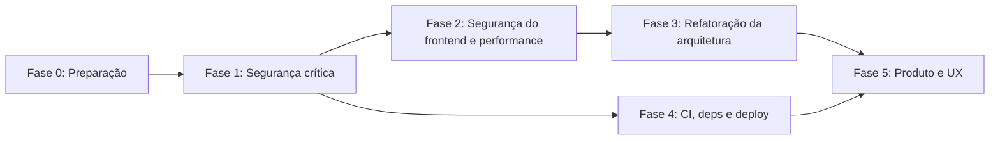

# Plano de Ação – PertoJá Marketplace

Repositório: https://github.com/JODROVI24/Servi-os-Marketplace-Engenharia-de-Software-main (branch `melhorias`)

> [!NOTE]
> **Status de execução na branch `melhorias`:**
> - **Fase 0 – Preparação:** Concluída (`docs/baseline.md`, branch `melhorias`, Neon Prod + Supabase Dev)
> - **Fase 1 – Segurança crítica:** Concluída (commits até `bf3b8db`)
> - **Fase 2 – Segurança do frontend e performance:** Concluída (commits `32f2a99`..`2c507e7`, medições pós-Fase 2 na Seção 8 de `docs/baseline.md`)
> - **Fase 3 – Refatoração da arquitetura:** Concluída (commits `a277fad`..`ae74b0b`; `app.py` com 80 linhas, 60 arquivos Python de produção ≤ 541 linhas, 8 Blueprints em `pertoja/blueprints/` e 8 ES modules em `public/js/modules/`)
> - **Fase 4 – CI, dependências e deploy:** Concluída (commits `d59ff70`..`20f9dc8`)
> - **Fase 5:** Pendente.

> [!IMPORTANT]
> Regra de cada fase: **os 114 testes existentes precisam continuar passando** (`python -m unittest discover -s tests -v`) e cada fase deve ter testes novos para o que mudou. Um PR ou commit por item, para facilitar a revisão.

---

## Fase 0 – Preparação (≈ 0,5 dia) ✅ Concluída

| # | Tarefa | Pronto quando |
|---|---|---|
| 0.1 | Instalar Git e criar a branch `melhorias` a partir de `main` | Branch criada |
| 0.2 | Criar o venv e instalar `requirements-dev.txt` | Testes rodam localmente |
| 0.3 | Registrar a linha de base: testes, Lighthouse (home, pedido, portais) e tempo de cold start na Vercel | Números salvos em `docs/baseline.md` |
| 0.4 | Criar banco PostgreSQL no Neon ou Supabase (dev e prod) | `DATABASE_URL` disponível |

---

## Fase 1 – Segurança crítica (≈ 1–2 dias) ✅ Concluída

| # | Item | O que fazer | Arquivos | Pronto quando |
|---|---|---|---|---|
| 1.1 | Contas demo | `ENABLE_DEMO_SEED` com padrão `'0'`; seed **proibido** se `VERCEL=1` ou `FLASK_ENV=production`; tirar as credenciais do README (ou marcar como "somente local") | `database.py` (~L1552, L1660), `README.md` | Teste: em modo produção, `carlos@pertoja.com`/`123456` não consegue logar |
| 1.2 | SECRET_KEY | Remover a derivação HMAC da `DATABASE_URL` e o `token_hex` aleatório; em produção, `RuntimeError` se a chave estiver ausente ou tiver menos de 32 caracteres; em dev, chave aleatória gravada em `.env` local | `app.py` L104-120, L243 | Teste: app em modo produção sem `SECRET_KEY` não sobe |
| 1.3 | Banco persistente | Em produção, exigir `DATABASE_URL` (falhar ao iniciar se cair no SQLite `/tmp`); documentar a configuração do Neon; rodar as migrations no Postgres | `database.py`, `api/index.py`, `README.md` | Deploy de preview usa Postgres; dados sobrevivem a um redeploy |
| 1.4 | Política de senha | Mínimo de 10 caracteres, checagem k-anonymity no HaveIBeenPwned (com timeout e fallback), mensagem clara no front | `app.py` L751, `cadastro.html`, `auth.js` | Testes para senha curta e senha vazada |
| 1.5 | CSRF | Rejeitar POST/PUT/PATCH/DELETE sem `Origin` **e** sem `Referer` (exceto webhooks); token CSRF (double-submit cookie) nas rotas de pagamento e perfil | `app.py` L137, `auth.js`, `script.js` | Testes: requisição sem cabeçalhos dá 403; com token, 200 |

---

## Fase 2 – Segurança do frontend e performance (≈ 3–4 dias) ✅ Concluída

| # | Item | O que fazer | Pronto quando |
|---|---|---|---|
| 2.1 | Tailwind no build | Criar `package.json` e `tailwind.config.js` (com o tema `perto-*` atual e os plugins forms e container-queries); gerar `public/dist/app.css` com o Tailwind CLI no build da Vercel; remover o `<script src="cdn.tailwindcss.com">` das 11 páginas | Nenhuma página carrega o CDN; visual idêntico (comparar screenshots) |
| 2.2 | Scripts inline | Mover os 16 blocos `<script>` inline para `public/js/<pagina>.js`; trocar `onclick=""` por `addEventListener` | `grep "<script>" public/*.html` sem resultados |
| 2.3 | CSP rígida | Remover `'unsafe-inline'` de `script-src` (e de `style-src`, se possível) e remover `cdn.tailwindcss.com` | Console sem violações de CSP em todas as páginas |
| 2.4 | Auditoria de `innerHTML` | Revisar os 74 usos: trocar por `textContent` ou criação de nós quando houver dado do usuário; nos demais, garantir a função de escape; adicionar regra de lint (`no-unsanitized`) | Teste com payload `` em nome, bio e endereço não executa |
| 2.5 | Rate limiter | Trocar a tabela `rate_limit` por Upstash Redis (com fallback em memória no dev); remover o `DELETE` a cada requisição; opcionalmente ativar o firewall da Vercel | p95 de `/api/*` cai em relação à linha de base |
| 2.6 | Imagens | Usar `<picture>` com `.webp` e fallback `.jpg`; `width`/`height` explícitos; `fetchpriority="high"` na imagem do hero | Lighthouse: LCP < 2,5 s e CLS < 0,1 |
| 2.7 | Medição | Rodar o Lighthouse de novo e comparar com a Fase 0 | Performance ≥ 90 na home |

---

## Fase 3 – Refatoração da arquitetura (≈ 5–7 dias) ✅ Concluída

> [!WARNING]
> É a fase mais arriscada. Faça a refatoração **sem mudar comportamento** e confie nos testes. Mova um Blueprint por vez.

| # | Item | O que fazer | Status |
|---|---|---|---|
| 3.1 | Estrutura em pacote | Criar `pertoja/` com `__init__.py` (padrão application factory `create_app()`), `config.py`, `extensions.py` | ✅ Concluído |
| 3.2 | Blueprints | Dividir as rotas do `app.py` em `auth`, `providers`, `services`, `orders`, `payments`, `webhooks`, `llm`, `pages` | ✅ Concluído |
| 3.3 | Camada de dados | Separar `database.py` em `db/connection.py`, `db/migrations.py`, `db/seed.py` e `repositories/*.py` | ✅ Concluído |
| 3.4 | Pagamentos | Dividir `payment_adapters.py` em um arquivo por gateway (`mercadopago.py`, `stripe.py`, `pagseguro.py`, `sandbox.py`) sob uma interface comum | ✅ Concluído |
| 3.5 | Frontend modular | Dividir o `script.js` em módulos ES (`map.js`, `geocode.js`, `orders.js`, `ui.js`, etc.) e extrair o JS compartilhado dos portais | ✅ Concluído |
| 3.6 | Logging | Trocar os `print()` por `logging` estruturado em JSON; revisar `except Exception` (capturar exceções específicas e logar com contexto); integrar o Sentry (opcional) | ✅ Concluído |
| 3.7 | Fonte única de cabeçalhos | Manter os cabeçalhos de segurança só no `vercel.json` carregados dinamicamente via `pertoja/security_headers.py` | ✅ Concluído |
| 3.8 | LLM | Priorizar APIs oficiais (OpenAI ou Gemini) com chave própria sobre FreeLLMAPI e garantir zero dados pessoais (PII) nos prompts | ✅ Concluído |

**Pronto quando:** `app.py` tiver menos de 100 linhas, nenhum arquivo Python passar de cerca de 600 linhas e todos os testes passarem.

> [!TIP]
> **Entregue na Fase 3:** `app.py` reduzido para 80 linhas, 60 arquivos Python de produção todos ≤ 541 linhas (`0` `print()` e `0` `except Exception` genéricos), cabeçalhos únicos carregados de `vercel.json`, frontend modularizado em `public/js/modules/` (`type="module"`) e suíte estrutural em `tests/test_phase3_architecture.py` (152 testes com cobertura acima de 80%).

---

## Fase 4 – CI, dependências e deploy (≈ 1–2 dias) ✅ Concluída

*(pode rodar em paralelo à Fase 2 ou 3)*

| # | Item | O que fazer |
|---|---|---|
| 4.1 | Fixar dependências | Migrar para `pyproject.toml` com lock (`uv` ou `pip-tools`); unificar `requirements.txt` e `api/requirements.txt` |
| 4.2 | Lint e formatação | `ruff check` + `ruff format`; ESLint para o JS |
| 4.3 | Cobertura | `pytest --cov` com mínimo de 80% |
| 4.4 | Segurança | `pip-audit`, `npm audit` e Dependabot |
| 4.5 | Teste JS | Rodar `tests/test_vercel_routing_adversarial.js` no CI (job de Node) |
| 4.6 | Vercel | Trocar `"includeFiles": "**"` por uma lista explícita (`pertoja/**`, `scripts/migrations/**`); ampliar o `.vercelignore` |
| 4.7 | README | Corrigir os pré-requisitos (tirar Pillow ou adicioná-lo), banco (Postgres em produção), seção sem título, credenciais demo, variáveis obrigatórias |
| 4.8 | SEO | `og:url` canônico sem `/index.html`; `og:image` específico por página; `<link rel="canonical">` |

---

## Fase 5 – Produto e UX (≈ 5–10 dias) 🧭 Pendente

| # | Item | O que fazer |
|---|---|---|
| 5.1 | Rastreamento honesto | Rotular "posição estimada" **ou** implementar posição real: o prestador envia o GPS a cada 10–15 s e o cliente consulta por polling (ou SSE) |
| 5.2 | Verificação de e-mail | Token de confirmação por e-mail (Resend, SendGrid); bloquear pedidos até a confirmação |
| 5.3 | Recuperação de senha | Fluxo "esqueci a senha" com token de uso único que expira em 30 min |
| 5.4 | Telefone (opcional) | OTP por SMS ou WhatsApp para prestadores |
| 5.5 | Nominatim | Proxy no backend com cache (tabela `geocode_cache`), User-Agent identificado e no máximo 1 req/s (política de uso do OSM) |

---

## Cronograma resumido

| Semana | Fases |
|---|---|
| 1 | Fase 0 + Fase 1 + início da Fase 4 |
| 2 | Fase 2 + conclusão da Fase 4 |
| 3–4 | Fase 3 |
| 5–6 | Fase 5 |

**Total estimado:** cerca de 4 a 6 semanas para 1 desenvolvedor.

## Riscos

| Risco | Mitigação |
|---|---|
| A refatoração quebra fluxos não cobertos por teste | Escrever testes de caracterização antes de mover o código |
| A troca do Tailwind CDN altera o visual | Comparar screenshots antes e depois em cada página |
| A CSP rígida bloqueia o SDK do Mercado Pago | Testar o checkout no sandbox; usar nonce se for preciso |
| A migração de SQLite para Postgres traz diferenças de SQL | Rodar a suíte de testes nos dois motores no CI (matriz) |
